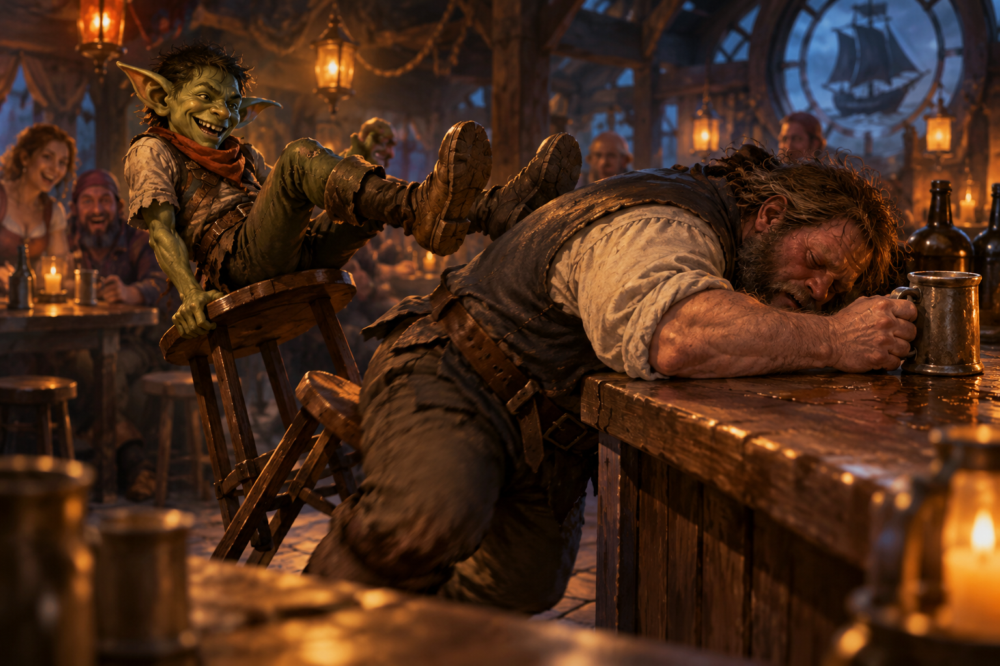

# A little light gardening

> *Ravenlost came looking for answers about Glim Brightstone. All they had to do first was a little gardening. How hard could that be?*

---

## The price of knowledge

Osgood Escar had agreed to tell Ravenlost what he knew about Glim Brightstone. But first, he needed help with a problem in his greenhouse.

It wasn’t a small greenhouse. Osgood had spent decades filling the enormous steel-and-glass structure with rare plants collected from across Ravenloft. Some were beautiful. Some were dangerous. An entire section, appropriately named the **Death Garden**, was dedicated to poisonous specimens.

And somewhere among his collection, something had gone terribly wrong.

Years earlier, Osgood and some fellow adventurers had encountered a Golthias blight. They had destroyed the creature, but Osgood kept a cutting and eventually grafted it onto a birch tree in his greenhouse.

According to Osgood, Golthias blights were associated with the dark energy of vampires. In Barovian folklore, driving a wooden stake through a slain vampire's heart could cause a terrible tree to grow where the vampire fell, spawning blights from its roots and branches.

Osgood's cutting had proved useful, at least initially.

He discovered that its sap could be distilled into a tincture capable of extending his life. It was one reason he remained alive more than seventy years after purchasing Welkspring House at approximately fifty years of age.

Unfortunately, the treatment had side effects.

Osgood was missing a hand. One leg had twisted into something resembling a wooden branch, with a foot at the end. His bandaged eye concealed another disturbing transformation — a wood-filled eye socket.

Each injection had caused the corruption to spread through the surrounding flesh. Glim had helped him manage some of the damage, but even that hadn't been enough. 

Osgood temporarily stopped taking the tincture, but he wanted to resume using it. He wasn’t ready to die, and certainly not in Mordent.

Now the grafted tree was growing out of control. Osgood suspected its roots had contaminated the greenhouse's water supply, allowing corruption to spread into the surrounding woods. The strange plant creatures Ravenlost had encountered on their journey to Welkspring House might have originated there.

He wanted the party to destroy the blight, but not before retrieving specimens for further study. Burning the greenhouse was out of the question. It represented decades of work.

In exchange, Osgood promised information about Glim.

For Ravenlost, that was reason enough.

---

## A garden full of surprises

Before entering, the party asked Osgood about his collection of poisons.

Cadric was particularly interested.

Osgood described several specimens, including **hemlock**, which could render a victim unconscious; **deadly nightshade**, which caused paralysis; and **giant hogweed sap**, which could severely damage exposed flesh. He also mentioned **blue looper**, a substance that left a persistent blue mark on the skin.

Cadric listened with considerable interest.

The party also learned that Osgood's greenhouse contained a locked section housing his most dangerous plants. He warned them to leave that room alone.

Naturally, this made it particularly interesting.

After a short rest, Ravenlost prepared to enter the greenhouse. First, however, they needed a key.

They followed Osgood outside. He whistled.

A decorative topiary dog sprang to life, bounded off its pedestal, and approached like an enthusiastic Labrador. As Osgood petted its neck, a panel opened in its chest, exposing mechanical components. Osgood reached inside and retrieved the key.

Cadric turned toward Jain.

“See? I told you not to touch the plants.”

The dog, apparently, had been a machine all along. It was another reminder of Glim's influence on Welkspring House. Osgood's automaton, Gustav, was not the only remarkable piece of machinery on the property.

Then the party entered the greenhouse.

Inside, the air was hot and oppressively humid. They were greeted by a fountain as they entered. Stone pathways wound between dense vegetation, small waterways, and unfamiliar plants. The greenhouse was large enough that its farthest reaches disappeared behind walls of greenery.

And something was moving beneath the soil.

---

## The tree that fought back

The party cautiously followed separate paths through the greenhouse, watching for signs of the corrupted birch.

They found it.

The tree was enormous, with twisted branches and unnatural purple growths. Its roots extended beneath the surrounding paths, and its vines moved with a purpose that no ordinary plant should possess.

As Ravenlost approached, the tree attacked.

Vines lashed out from the path in different parts of the greenhouse, wrapping around limbs and dragging their victims toward the trunk. Roots erupted from the soil. The tree itself began moving, advancing through the greenhouse as though it had simply decided to uproot itself and go hunting.

Bia drew her axe and charged into the fight, raging as she hacked at the creature's branches and roots.

Jain used *Jump* to launch herself into the tree, attempting to strike it from above. Her first attack bounced harmlessly off the bark, and the creature threw her away.

Undeterred, she jumped back into the tree a second time.

The blight retaliated with a particularly vicious attack. One of its vines wounded Jain, draining her strength with necrotic energy.

Cadric found another use for *Cloud of Daggers*, positioning the spinning blades to shred the plant growth like a magical lawnmower.

Elisandra attacked with radiant magic, which appeared especially effective against the corrupted tree.

Meanwhile, Jain had another objective.

After removing the poison vine from her leg, she reached the locked Death Garden and picked its lock, narrowly avoiding a concealed needle trap. Having barely survived the tree's attacks, she was not about to let a locked door keep her from exploring Osgood's most dangerous collection.

But her injuries were catching up with her.

Jain eventually withdrew to rest on a chaise lounge in the Death Garden while the others continued fighting.

Bia remained in the thick of the battle, chopping at the tree while Cadric and Elisandra attacked from their positions.

Finally, Elisandra struck the creature with a powerful burst of radiant energy.

The corrupted tree fell.

Osgood's greenhouse—what was left of it, anyway—was safe.

Or at least, the most obviously murderous plant was dead. 

---

## Something in the water

With the battle over, Ravenlost turned its attention to the greenhouse's water supply.

At first, the water appeared perfectly clear.

But closer inspection revealed something disturbing.

Roots extending into the pond were releasing tiny black and purple particles. The contamination was entering the water inside the greenhouse, then flowing out through its drainage system.

The roots were already beginning to wither now that the blight had been destroyed. 

The discovery raised another concern. If the runoff was carrying the contamination into the surrounding forest, what else might have been affected?

As Osgood requested, the party collected a large branch specimen from the blight. They also collected water samples from the greenhouse’s waterways for Osgood to examine.

And Cadric was already about where he wanted to go next. Osgood had mentioned a hemlock grove downstream. Cadric was already interested in visiting it.

But first, Ravenlost had earned some answers.

---

## Fifty-nine years ago

Upon receiving the blight specimen, Osgood was true to his word and began providing answers. 

Osgood had known Glim Brightstone for many years.

He spoke fondly of the inventor, whose expertise with automatons had eventually expanded into far more ambitious experiments.

Glim had last worked at Welkspring House **fifty-nine years earlier**. His final visit had been unlike the others.

Glim arrived distressed, carrying a satchel filled with glimmer rune cells. At Welkspring House, he destroyed much of his research, including notes and schematics, and apologized to Osgood for the danger he had brought to the house.

Before leaving, he dismantled an unusually large battery.

He broke it into three pieces and gave one to Osgood for safekeeping.

Now, Osgood reached beneath his clothing and drew out a leather cord. Hanging from it was a strange metal charm.

It was shaped like a helix, approximately five inches long, cold to the touch, and unexpectedly heavy. Intricate blue runes covered its surface. Unlike an ordinary Glim battery, which had a single line of runes, this fragment carried three lines along each face of the helix.

There were approximately three times as many runes as Ravenlost had seen on other batteries.

The device looked less like a magical artifact than a piece of sophisticated machinery.

An *Identify* spell revealed no conventional spell used in its construction, but suggested a connection to contacting other planes.

Could the device help something—or someone—return from another plane?

It was an unsettling possibility. And Ravenlost already knew someone who might be interested in returning from the dead.

Lord Godfroy.

---

## A machine to pierce the Mists

Osgood described the machine Glim had been developing.

It resembled a horizontal barrel surrounded by glass tubes, with a central core and two forward-pointing rods. A control panel at the rear contained buttons, switches, and wooden levers used to aim the rods independently.

The enormous battery had been designed to power it.

Glim believed the machine could pierce the Mists separating Ravenloft's domains.

Osgood had witnessed a test. The device produced a blinding light and opened a passage approximately ten feet across, extending into the Mists farther than Osgood could see.

Glim hoped his research might eventually eliminate the barriers between the domains entirely.

But that was not the only application he had explored.

Osgood revealed that Glim had successfully removed souls from animals during his experiments. He had also considered whether a soul could be transferred into another body.

The implications were enormous.

Ravenlost had been sent by Godfroy to recover Glim's technology. Godfroy was a ghost who couldn’t leave Griffin Hill.

Was he hoping to use Glim's machine to restore himself to a living body?

The party couldn't prove it, but the possibility was becoming difficult to ignore.

They discussed ways to prevent Godfroy from using the technology, including sabotaging the machine or replacing part of the battery with something dangerous. Spells such as *Nondetection* and *Nystul's Magic Aura* might help conceal their actions.

For now, though, they had no definite plan.

Osgood agreed to lend them his battery fragment.

Concerned that Godfroy might somehow scry on the device, Ravenlost decided not to place it loose inside Elisandra's bag of holding. Unfortunately, nobody had any spare cloth.

Osgood provided a pouch.

They placed the helix inside it, then tucked the pouch safely into the bag.

---

## The missing peninsula

Osgood had one more lead.

North of Abbey Point lay a wooded peninsula absent from ordinary maps. He had visited the area with Glim many years earlier.

There was an abbey there, inhabited by monks whose behavior Osgood had found unsettling.

More importantly, there was a cave containing substantial deposits of silver. Glim had intended to use the cave as a vault, employing what he called his *lunar rites* to imbue the silver.

Osgood marked the location on Ravenlost's map.

He didn’t know whether Glim had completed the vault, or what might remain inside. But it was the best lead the party had.

Before they departed, Osgood also offered healing potions, poison supplies, and a letter introducing them to Mikhail at the hospital for their journey on to Falkovnia. He asked only that they return his battery fragment someday and bring him news of Glim.

Ravenlost promised to try.

First, however, Cadric wanted some hemlock.

---

## The hemlock grove

The party followed the greenhouse's runoff downhill toward the coast.

By then, darkness had fallen. Cadric and Elisandra used their custom-designed EC lights to illuminate the path. Bia and Jain relied on their darkvision.

Eventually, the group reached a marshy grove filled with white and, curiously, purple hemlock flowers. Purple wasn’t a natural color for hemlock.

Cadric was for now only interested in the white flowers, which he could process into contact poison. The others helped him search.

Then Jain noticed eyes watching from the vegetation. The rest of Ravenlost looked around and saw them too.

Eight pairs of eyes.

One pair was considerably larger than the others. The creature that emerged with those eyes was an enormous frog, but unlike any frog Ravenlost had ever seen.

White flowers covered its head and back. More blossoms lined the inside of its mouth, releasing pollen whenever it opened its jaws.

Smaller frogs lurked among the plants.

And they were hungry.

---

## Swallowed whole

Bia charged the enormous flower-covered frog, striking it with her axe before entering her rage. The frog answered by lashing out with its tongue.

It wrapped around Bia, restraining her and pulling her toward its enormous mouth. She resisted the initial poison. That didn't prevent the creature from swallowing her. One moment Bia was fighting the frog. The next, she was inside it.

She continued attacking from within its mouth, even managing to thrust her axe through it.

Outside, the others fought desperately against the smaller frogs.

Their tongues could grapple opponents, while their bites delivered poison. Ravenlost was rapidly discovering that collecting flowers was much more dangerous than expected.

Cadric cast *Cloud of Daggers*. The spinning blades tore through the enormous frog, finally killing it.

Bia was free!

Unfortunately, she emerged from its stomach directly into Cadric's spell. The same magical blades that had killed the frog now sliced into the barbarian.

Oops.

There was little time to complain. 

Another frog had swallowed Elisandra. Trapped inside, she decided to cast *Shatter*.

The spell worked spectacularly. The frog exploded.

A side effect was that Elisandra was thrown out of the creature's ruptured body. She landed unconscious on the ground. It was an impressive victory, but one that had very nearly killed its caster.

Jain rushed toward her, using *Jump* to cover the distance and attempting to stabilize her. Healing magic eventually brought Elisandra back to consciousness.

Bia, meanwhile, was still fighting.

Another frog struck her with a devastating bite. The attack should have knocked her unconscious, but her orcish **Relentless Endurance** allowed her to remain standing with a single hit point.

The remaining frogs were eventually defeated.

Ravenlost had survived.

Barely.

And all because Cadric wanted some flowers.

---

## A successful harvest

Once the fighting ended, Cadric finally gathered his hemlock.

He collected **twelve full doses of ordinary white hemlock**. He then also collected  three doses of the unusual purple variety. He intended to have Osgood investigate the purple flowers, whose properties remained unknown.

Bia also collected a purple flower. Quietly. She was a farmer, after all, and an unusual plant was an unusual plant. There was no particular reason the others needed to know about it.

Exhausted, injured, and carrying more poison than they had started with, Ravenlost returned to Welkspring House.

---

## Gustav, the helpful automaton

It was late when the party arrived.

Blue runes glowed along the estate's gates, fences, and greenhouse framework, their light especially striking beneath the moon.

Osgood was waiting in his sitting room.

Gustav was also there, doing his best to be helpful.

When Jain asked Gustav to fetch sugar, the automaton returned, pushing an enormous twenty-five-pound barrel.

Osgood was horrified.

That was all the sugar they had.

Jain then asked Gustav for water and lemons. Gustav needed an explanation of what a lemon was.

“Yellow. Sour. A fruit.”

The party speculated that Gustov might return with brownies painted yellow. Osgood had apparently grown accustomed to such misunderstandings.

Cadric showed Osgood the purple hemlock. Osgood agreed to study it, along with the blight specimen recovered from the greenhouse.

The party also expressed interest in whether the blight's ability to transform living tissue into wood could be separated or intensified.

Osgood was somewhat alarmed by their fascination with increasingly unpleasant poisons. Nevertheless, he agreed to add that to his research.

Ravenlost finally settled in for a long rest.

There were no proper guest accommodations, but after the battle with the frogs, a place to sleep was more than enough.

During the evening, Osgood also acknowledged something the party had suspected: Glim had been more than a friend.

The revelation gave his concern for the missing inventor a more personal meaning.

---

## A farewell to Welkspring House

The next morning, Ravenlost thanked Osgood for his hospitality.

He provided four additional vials whose contents would be explained later and promised to investigate the specimens the party had collected.

He asked them once again to bring him news of Glim.

The party said goodbye to Gustav and set off through the woods.

With the greenhouse blight destroyed, Osgood believed the surrounding forest should be safer. He asked Ravenlost to let Ava know she could return to Welkspring House.

They found her near her home, cutting trees and working on wooden sculptures.

Ava was pleased to hear that the woods were safe.

She was less interested in returning to work.

Osgood had paid her **an entire year's wages** to stay away from the estate, and she intended to enjoy her time off.

Ravenlost couldn't really blame her.

---

## The wandering halfling

Back at the sailors' lodging, the party found a hung-over Shauncey and collected enough cured fish for their next voyage.

Cadric had something else to share.

Another installment of his increasingly elaborate ballad about Ravenlost.

He had been writing verses about his companions, complete with a chorus and bridge. 

This performance included a verse about Jain, describing the dangerous Lupine he had encountered in the Mists.

Rather than confront the fearsome creature, the wandering halfling had offered her a meal.

*And on Cadric wandered, where cold shadows lay,*  
*where the fog swallowed moonlight and hid the pathway.*  
*Lupine came stalking, her eyes very bright.*  
*Her fangs and her fur were dark as the night.*  
*For the dead may be restless and beasts may draw near,*  
*And the mist has 1000 dark secrets to fear.*  
*But Cadrick just grinned at the brute ready to feed.*  
*Come now, my furry friend, and let's share this fine mead.*

The performance received a mixed reaction, but it was enough to wake a passed-out Jethro.

Cadric still had more verses to write, including one for Elisandra.

His epic was becoming an ambitious undertaking.

---

## A captain and a promise

Captain Jethro Fletcher was finally sober.

Ravenlost had originally arranged passage in exchange for six cases of hard liquor, delivered in installments.

Now they needed him to take them somewhere else.

Abbey Point.

Cadric assured Jethro that the abbey was home to master brewers.

This was a particularly effective argument.

Jethro was persuaded to extend the voyage, especially after the party promised him a barrel of liquor.

He made it clear that Abbey Point would be his final destination.

The party would also need him to wait while they obtained the promised barrel.

That was a problem for later.

For now, they boarded *The Fletcher* and set sail.

---

## **Abbey Point**

The voyage took approximately fourteen hours.

As the ship traveled north, the Mists grew increasingly imposing.

They rose along either side of the peninsula, forming towering walls of fog. Ahead lay a narrow opening, as though the land itself had been carved out of the surrounding darkness.

The journey passed without incident.

At approximately ten o'clock that night, Ravenlost arrived at Abbey Point.

High above the shoreline stood a crumbling abbey.

Candlelight flickered behind its windows.

Shadows moved inside.

Below, a dock extended into the water. A fishing boat was tied alongside it, and several overturned canoes lay nearby.

Jethro brought *The Fletcher* alongside the dock.

Somewhere beyond the abbey, in a cave rich with silver, Glim Brightstone might have hidden the answers Ravenlost had been seeking.

And if the party's suspicions were correct, those answers could reveal what Lord Godfroy truly intended.

But first, they would have to deal with the abbey.

And its mysterious inhabitants.

**Ravenlost had reached Abbey Point.**
