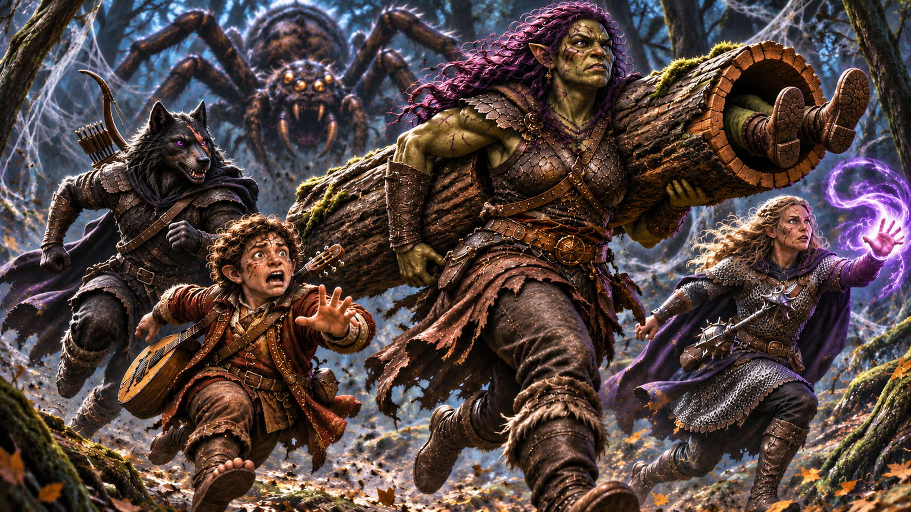

# The secrets of the silver mine

> *An abbey without ale, a forest full of spiders, a soldier with unfortunate news, and a mine full of things that refuse to stay dead. Ravenlost really needs to find a better travel agent.*

---

## A night at the abbey

The boat brought Ravenlost to Abbey Point after dark. From the shore, a steep path of shale steps climbed toward an abbey overlooking the coast. The well-light abbey was backdropped by the mists in the distance.

Captain **Jethro Fletcher** remained aboard his vessel, leaving his first mate, **Gobbo**, to accompany Bia, Cadric, Jain, and Elisandra up the path. Before leaving, the party promised Fletcher a barrel of ale from the abbey. It seemed like a reasonable arrangement. Surely an abbey would have ale.

Unfortunately, Ravenlost was about to discover two things about the monks of Abbey Point.

First, they had sworn vows of silence.

Second, **the abbey was completely dry**.

No ale. No wine. Not even something conveniently described as medicinal alcohol. Fletcher's promised barrel was looking increasingly unlikely.

At the entrance, Ravenlost encountered **Davos**, a monk who communicated through sign language. Luckily, Bia was fluent in sign language. 

Davos offered to provide food and shelter for the travelers. He also provided more information about the abbey. The abbey was home to seventeen monks devoted to **Ezra, the Lady of the Mists**. 

He led the visitors to a room where they were given stew, bread, milk, blankets, and pillows. It was a welcome change from sleeping aboard the boat, even if the hospitality came without a single drop of ale.

Ravenlost had not come merely for shelter. Lord Godfroy had sent them to investigate **Glim Brightstone**, and the abandoned silver mine in the mountains might hold information about his activities.

The monks knew the mine. They also knew the surrounding forest was dangerous.

Davos informed them that for roughly the last two years, giant spiders had occupied the woods. Creatures also sometimes emerged through the mists, and the monks rarely ventured far from the abbey. 

He left them to sleep and promised to introduce them to their Abbot in the morning. He also informed them that they could not venture anywhere else in the abbey, but to just knock on the door to the next room if they needed anything. 

Being told not to go somewhere was the wrong thing to say to Ravenlost. They recalled the windows outside were approximately 9 feet high. They could possibly raise Cadric on Bia’s shoulders to look in. Or Jain, who’d recently practiced climbing, could try jumping and climbing to take a peek. 

In the end, they decided to just go to sleep. Very un-Ravenlost-like.

---

## Abbot Katun

The following morning, the party met **Abbot Katun**, the elderly leader of the monastery. Like the other monks, Katun observed a vow of silence, but he was able to communicate more information about Glim and the mine than Davos.

Glim Brightstone had owned the silver mine, which was managed by a foreman named **Polk**. During its working years, silver was transported along the forest trail to the coast and then sent off toward Echo Island.

Glim had also visited the abbey to study writings and symbols associated with Ezra. The abbot remembered him departing for the mountains with a covered wagon carrying something concealed.

More recently, five travelers from Mordenshire had stayed at the abbey before heading toward the mine. That had been seven or eight months earlier. None of them had returned.

After answering all their questions, the abbot presented them with some sandwiches for their journey, which would take about a day and a half. 

Before departing, and now that it was daylight, Ravenlost examined the stonework around the abbey's entrance. Weathered runes carved into the sword-and-shield decoration appeared to be connected to symbols associated with Glim. And in the distance, toward the min, the mists seemed to be closing in on both sides of the mountain.

The party left with provisions for the journey, a better understanding of the mine's history, and considerably less confidence in its ability to deliver Fletcher's ale.

Gobbo continued with them.

---

## A spider, an elk, and a goblin in a log

The old mining trail hadn’t been maintained in decades.

Trees and undergrowth crowded its edges, and the forest grew unnaturally quiet as Ravenlost moved deeper into it. There were no birds singing overhead, only the occasional rustle of vegetation and the sounds of the party making its way along the path.

Then they heard something struggling in the distance.

Following the noise, Ravenlost came upon an enormous web stretched between trees near a creek. Caught in its sticky strands was a large male elk.

The animal was still alive, but it was trapped so thoroughly that its attempts to escape only made it struggle harder. Its wide eyes followed the approaching adventurers. 

The party decided to help. 

Working through the thick webbing, they managed to free the terrified elk. But there was an obvious question. What kind of spider could build a web large enough to catch an elk?

They were about to find out.

Movement stirred in the canopy. Gobbo, apparently deciding that discretion was the better part of valor, sought refuge inside a hollow log. Unfortunately, the log proved to be both an excellent hiding place and a terrible escape route.

Gobbo became stuck. And Ravenlost was ready to run back to the trail. 

With a giant spider approaching, Bia had little patience for extracting one goblin from a log. Rather than leave Fletcher's first mate behind, she picked up the entire log and ran with it away from danger. She was then able to free him safely. 

Back on the trail and above them, the spider had followed them and emerged from the trees with terrifying speed. It was approximately the size of a horse.

Ravenlost turned to face it. The creature lunged from the canopy, but its attack failed to bring down the party. Jain struck it hard, and Bia helped finish the fight. 

Once the enormous spider lay dead, the party took the opportunity to collect a few souvenirs. Jain recovered all eight of its legs, while Cadric collected a vial of spider goo. Because you never know when you’ll need some spider goo.

The legs and goo went into **Elisandra's bag of holding**, along with the party's other collected supplies. 

With Gobbo freed from his log and the elk safely gone, Ravenlost resumed its journey. 

They had survived one enormous spider.

Unfortunately, the forest contained considerably more webbing.

---

## The soldier in the web

Several uneventful hours later, the trail bent around a dense tangle of brambles. Beyond it, the trees were lined with silk-wrapped sacks.

Some hung from branches. Others rested near the ground. They varied enormously in size, and a thick layer of webbing stretched across the path at approximately knee height.

Rather than risk becoming trapped, the party used their torches to burn a path through the silk. 

The webbing caught fire easily. As the flames spread, several of the suspended sacks dropped to the ground.

Ravenlost continued cautiously, taking care not to step on anything wrapped in silk. There was no telling what the spiders had stored inside.

Then one of the sacks began moving. Whatever was trapped inside was still alive.

Unable to ignore the movement—or their own curiosity—the adventurers carefully cut open the silk. Inside was a badly injured male soldier wearing leather armor. His shoulder bore a festering wound, and the armor on his chest displayed the insignia of a large bird's talon.

More importantly, **he was still alive**.

The man looked around in confusion. He thanked his rescuers and asked where he was.

His name was **Ala'kir**.

---

## News from Falkovnia

As Elisandra tended Ala'kir's injuries, Bia began questioning the soldier about his homeland.

Ala'kir recognized her as an orc and suspected she might be from Falkovnia. He asked whether she had been home recently.

Bia explained that she left home about six weeks ago.

Ala'kir's news was grim.

Approximately six weeks earlier, massive hordes of undead had begun sweeping across Falkovnia. The attacks were relentless, and the military had struggled to hold them back.

Ala'kir's own regiment had suffered devastating losses. By the time his soldiers reached the mists, only ten remained. When they emerged in Mordent, there were just three.

Bia wanted to know more.

"Where were you heading when you entered the mists?" she asked. "Was it an accident?"

Before Ala'kir could finish answering, Jain turned to Cadric.

"Why are we still talking to him? We rescued him. That doesn't make him our responsibility."

"Maybe Bia wants to keep him," Cadric suggested.

Jain glanced at Bia, who was still waiting for Ala'kir's answer.

"Keep him? Why?"

"Well, look at her. She's awfully chatty. Maybe she finds him attractive," Cadric said.

"Are you jealous?"

"Jealous? I'm just making an observation."

"Then why don't you ask her?"

Cadric considered this. "Maybe she's hoping to bring him along. You know, spend a little more time together."

"Or," Jain suggested, "we could just put an arrow through his head and be done with it."

“Whoa,” replied Cadric. “He’s wearing a nice looking helmet. We wouldn’t want to damage it.”

Bia turned toward them.

"Can I hear what's happening in Falkovnia first? *Then* you can put an arrow through his head."

Cadric nodded thoughtfully. "See? She definitely likes him."

“Wait, so you’re saying that after I put an arrow in his head, then she might be attracted to him?”

Throughout this exchange, Ala'kir had been looking from one adventurer to another, trying to understand what was happening.

Finally, he interrupted.

"Am I dead?"

"No," Bia replied. "Not yet. But if you hang around with us, you’ll probably wish you were."

Ala'kir looked considerably less reassured than she might have hoped.

"And don't make eye contact with the goblin," Cadric said, gesturing toward Gobbo, who had two of his eight knives out. 

Ala'kir decided it was probably best to continue answering Bia's questions.

He described the fall of defensive positions in Falkovnia, including **Fort Watten** along the southern border. The undead had breached its walls, forcing survivors to retreat.

The attacks weren't limited to a single direction. Undead were advancing through the region, threatening settlements and driving survivors toward whatever fortified positions remained.

"Wait," Bia interrupted. "So they're coming from the south and heading north?"

"Both directions," Ala'kir explained.

Bia listened with growing concern. She had left Falkovnia just over six weeks earlier, right before the undead began overrunning the region. Her adoptive father, Tobin Underfoot, and her sister, Mira, were still there. Were they safe? Had the undead reached their village? Had they managed to find shelter behind the walls of one of Falkovnia's remaining strongholds?

Suddenly, Ala'kir's account wasn't merely news from home. It was news that could determine whether Bia still had a home—and a family—to return to.

Her companions, meanwhile, were still considerably more interested in whether she fancied the soldier. 

And Ala'kir was beginning to wonder whether surviving the spiders had actually improved his situation.

---

## More trouble in the sacks

The group still faced the problem of the remaining silk bundles. Some appeared to contain animals. Others were large enough to hold humanoids. Could any of them be Ala’kir’s missing travel companions?

Curiosity won again.

As the party examined the different-sized fallen sacks, they discovered the remains of several unfortunate creatures, including an elk, a partially digested hobgoblin, and humanoid and canine-humanoid bones.

Then Elisandra opened a sack that contained something considerably more dangerous.

A swarm of tiny spiders spilled out. The creatures were small, but their venom was potent. They overwhelmed Elisandra, poisoning and paralyzing her before the party could destroy the swarm with magic.

The danger wasn't over.

Another large bundle contained what appeared to be a dead ogre, its body covered in spider bites. 

Unfortunately, the ogre wasn't content to remain dead. It rose as an undead creature and attacked.

With Ala’kir’s help Ravenlost fought the enormous corpse. Gobbo also joined the battle, demonstrating that Fletcher's first mate was considerably more useful with a blade than he had been inside a hollow log.

The fight ended when **Gobbo decapitated the undead ogre**.

After the battle, the party had little interest in opening additional sacks.

They had already discovered that the forest's spiders were capable of collecting an extraordinary variety of dangerous things.

---

## A name from Bia's past

Before they separated, Ravenlost asked Ala'kir whom they should seek out when they eventually reached Falkovnia.

He recommended finding refuge within a walled settlement, particularly the stronghold at Lekar. He also provided the name of the military commander leading its defense.

**Commander Korath.**

Bia froze.

"What the shit?"

She knew that name. The first time she'd heard it, she was only six years old.

Her Orc village in Falkovnia had been attacked during a foggy, rainy night. Her mother, Anthea, had hidden her in a cellar with a wooden doll, telling her to remain there.

From her hiding place, Bia heard screams and the sounds of fighting. And somewhere amid the chaos, she heard someone or something speak a name.

**Korath.**

When Bia finally emerged two days later, her father, Voros, was dead. Her mother was missing, and the village had been destroyed. 

Bia eventually found another village elsewhere in Falkovnia. After finding her alone in the woods, she was taken in by the widowed halfling Tobin Underfoot and his daughter, Mira.

For years, Bia believed the attack had been carried out by a rival orc clan. But that wasn't the only time she'd heard the name Korath.

Years later, during an attack on a farm, Bia had fought to defend the village. She had saved its people, but something about the battle had frightened several children who witnessed it. 

The strange thing was that **Bia couldn't remember the fight**.

She could guess what had happened after seeing the carnage she left behind. She knew she'd saved the village, and she knew some of the children had been afraid of her.

But the battle itself was missing from her memory. One thing, however, had remained.

The name **Korath**. 

Repeated again through the mist that came in.

And now, standing in a spider-infested forest in Mordent, she was hearing it for the third time. This time, it belonged to a military commander supposedly protecting Falkovnia's surviving population.

Was this the same Korath whose name she'd heard during her childhood? Was he somehow connected to the mysterious fight at the farm?

Or were these three encounters entirely unrelated?

Bia had no answers.

But with Tobin and Mira still in Falkovnia, an undead invasion threatening her homeland, and the name Korath resurfacing yet again, she had more reasons than ever to return.

---

## Parting ways

Ravenlost invited Ala’kir to join them on their journey to the mine. Knowing the impression they made, they already knew the answer. So they told him about the Abbey on the shore, which sounded like a much better option. 

Gabbo also had had enough. 

But one thing was missing. His captain’s treasure. Gabbo couldn’t return to the ship empty handed.

Bia had no patience for negotiating. She needed to finish this job, and then she was heading straight to Falkovnia—with or without the others. Yes, they had a job to do in Falkovnia, but she needed to know whether her family was safe. She’d already lost her parents. She couldn’t lose the family that saved her too.

To make up for the lack of ale, Bia offered Gabbo **25 gold pieces**, with **10 intended for Gabbo** and **15 for Captain Fletcher**. It came with a warning. “When I return to Mordent, if I find out that you didn’t give Captain Fletcher his share, I will kill you myself.” 

Gabbo agreed. Whether he kept his promise will remain to be seen.

Ala'kir lit a torch, and the two companions headed back through the forest.

Ravenlost continued toward the silver mine.

---

## The abandoned mine

As evening approached, the party searched for a defensible place to camp. They found a sheltered location and established watches.

The forest remained unsettlingly active around them. Strange chittering echoed in the distance, and during one watch, a humanoid figure with multiple eyes was briefly glimpsed among the trees. It resembled something disturbingly close to a spider in human form. 

Fortunately, nothing approached the camp.

Later, the distant sounds seemed to move toward the mountain. 

By morning, Ravenlost was ready to continue. The trail eventually brought them to the abandoned silver mine.

The entrance had partially collapsed, and old spiderwebs covered the surrounding area. Whatever had once been a busy mining operation had been left to deteriorate for decades.

Bia set to work clearing the rubble. With her strength, the party was able to reopen a passage into the mine.

While she worked, the others examined the remains of the old camp.

Weather-beaten tents had collapsed under years of rain and neglect. Crates held ruined rations and abandoned mining supplies. They found detonator materials, wire, and cord, but no explosives.

More troubling were the signs that someone had visited the mine more recently. Tracks suggested that five humanoid travelers had approached the entrance.

Were these the same five visitors who had disappeared after leaving Abbey Point?

Ravenlost had no way to know. But the evidence suggested they were following the right trail.

---

## The dead miners

Inside, the mine was dark and abandoned.

Old rails ran through the tunnels, disappearing into passages that had once carried silver ore toward the surface. Flecks of silver remained visible in the rock.

The party soon discovered that the mine had not been abandoned peacefully.

In one chamber, skeletal remains lay scattered among the debris. Eight appeared to belong to miners. Another skeleton was distinctly different: a canine-humanoid creature with a pickaxe lodged in its skull.

Whatever had happened here, the miners had fought back.

Further exploration revealed barricades, ransacked supplies, and evidence of desperate attempts to defend the mine.

Some crates bore the letters **PMC**. Inside were useful supplies, including detonation cord, four boxed kerosene lanterns, and rope.

Anything worth keeping went into Elisandra's bag of holding.

Then Ravenlost discovered that not everyone who had worked in the mine had truly departed.

---

## Clem, the ghost of the mine

Among the abandoned crates, the party encountered a hunched figure.

At first, it was difficult to tell what they were looking at. Then the figure revealed itself to be a ghost.

His name was **Clem**.

He’d been trapped in the mine for an extraordinarily long time. **Fifty-eight years, seven months, and three days**, to be precise.

Clem remembered the mine when it was still operating. He recalled the attack that brought its work to an end: canine creatures had invaded the tunnels, and the miners had fought desperately to survive.

**Foreman Polk** had taken men toward the lower levels during the attack.

Clem also remembered Glim Brightstone bringing chests and a large covered object into the mine. Glim had departed after the vault was completed. 

More recently, another group had entered the mine in search of something valuable. Clem remembered them traveling toward the lower levels by elevator.

Only one had escaped, carrying a bag.

The account was especially troubling given the five travelers who had disappeared months earlier. 

Clem had other concerns.

The giant spiders had arrived approximately two years ago, and he was terrified of them. He warned the party about the creatures occupying the mine, including disturbing humanoid spider beings.

He also wanted something from Ravenlost. His remains were still somewhere inside the mine. 

If the party could recover them and provide a proper burial outside, perhaps Clem could finally be freed from the place where he had died.

The adventurers discussed how they might accomplish that without exposing themselves to the spiders. They also considered the dangers of releasing a ghost into the mists. Would he be confined to an eternity of servitude for Lord Godfroy? Or would he be free from that because he died so long ago?

For now, Clem's remains would have to wait. The vault was still somewhere below them. And Ravenlost had a mission to complete.

---

## The runaway minecart

The old minecart rails offered a route deeper into the workings. Unfortunately, they also concealed a trap.

As they continued through the mine, a minecart suddenly came racing down the track toward the party.

There was little time to react.

The cart hit Jain. Then Bia planted herself in its path and used her considerable strength to stop the runaway cart before it could strike Elisandra and Cadric.

The impact hurt. But the cart stopped. The party continued toward the elevator that once connected the mine's upper and lower levels. 

The lift was no longer functioning. Its controls were broken, and the platform rested far below. Approximately **85 feet** below. 

With no reliable way to operate the elevator, Ravenlost resorted to ropes. The descent wasn’t entirely successful. Elisandra lost her grip and fell, suffering a painful landing before receiving healing.

Eventually, the party regrouped on the lower level.

The tunnels below were quiet. 

That didn’t make them safe.

---

## The guardian of the vault

As Ravenlost explored the lower mine with their lit torches and EC lights, they found more evidence of the violence that had consumed it.

Numerous bodies suggested that a terrible battle had taken place here. Canine-humanoid remains lay among shattered defenses. Spears pointed inward toward a chamber, and scorch marks stained the surrounding stone. 

Nearby stood three red barrels. The party had good reason to suspect they contained something explosive.

Beyond the ruined defenses was the vault. Its massive silvered door glowed with an eerie blue light. The chamber seemed to be exactly what they had been searching for. 

But Ravenlost was not alone.

**Polk**, the mine's former foreman, still guarded the lower level.

Unfortunately, death had not relieved him of his duties. The undead foreman regarded the adventurers as intruders.

The party attempted to explain that they had come seeking information about Glim Brightstone. Polk wasn’t interested.

He attacked with dynamite.

Around him, skeletal miners began rising and entering through the stone walls to defend the vault.

Ravenlost had found Glim's secret chamber.

Now they had to survive long enough to enter it.

---

## Battle among the barricades

The lower mine erupted into chaos.

Polk attacked from behind the ruined defenses while skeletons advanced with pickaxes and clubs.

The party struggled to maneuver around the barricades, fallen debris, and explosive barrels.

Cadric used **Dissonant Whispers** to drive an enemy away, opening an opportunity for further attacks. **Cloud of Daggers** tore into the undead defenders, while the party combined weapons and magic to keep the skeletons from overwhelming them.

But Polk was a dangerous opponent.

His attacks struck hard, and the skeletons continued pressing forward.

Jain fell unconscious. Elisandra was also brought down during the fighting.

With two companions incapacitated, Ravenlost came dangerously close to disaster.

Healing magic and potions became as important as swords and spells.

Bia fought to protect the others, at one point carrying the unconscious Jain out of danger. 

The battle continued through the broken defenses as the party struggled to keep its wounded members alive. Polk refused to surrender, determined to defend Glim's property even in undeath. His stubbornness proved to be his downfall when Ravenlost finally defeated him. The remaining skeletons disappeared into ash.

The chamber fell silent.

The party had survived.

Barely.

---

## Inside Glim's vault

With Polk defeated, Ravenlost finally entered the vault.

The room contained several storage chests, several damaged automatons, and a floating dais. 

The dais was particularly interesting. It was clear that something large had once rested upon it. But whatever the device had been, it was gone.

The party searched for clues, including a matching three-pronged key or an unusually large battery, but found neither.

Someone had apparently reached the vault before them and removed the object. Perhaps it had been the survivor Clem remembered escaping with a bag.

Perhaps not.

The chamber also contained treasure and useful supplies.

Ravenlost recovered **400 gold pieces**, which they agreed to divide into shares of 100 gold per adventurer. They also found **two emeralds**, **two greater healing potions**, an unidentified potion containing what looked like suspended gas, and a revivify kit with one diamond remaining.

Three barrels of black powder were also among the supplies recovered.

The collected items were placed in **Elisandra's bag of holding**, with the gold shares accounted for separately.

The party had gained valuable resources.

But the missing object on the dais suggested they were already too late to recover whatever Glim had once concealed there.

---

## An unexpected guardian

After the exhausting fight, Ravenlost decided to rest inside the vault. Jain took the first watch while Bia, Cadric, and Elisandra slept.

Unfortunately, the party had overlooked one important detail: nobody had checked whether the damaged automatons still contained batteries.

Approximately two hours into Jain's watch, one of the machines suddenly came to life. The automaton seized Jain’s leg. Behind the narrow slits of its face, a soft blue light began to glow. The rest of the party awoke to the noise.

"Warning, intruders. On the authority of Brightstone, you must leave under threat of death."

The party tried to reason with the machine. They weren't thieves, they explained. They were searching for Glim Brightstone.

Elisandra reached into the bag of holding and showed the automaton the pendant they had received from Osgood.

The machine paused. A thin line of light passed across its glowing blue eye as it processed the information.

"Password."

Bia supplied the answer.

"Osgood."

"Password accepted."

The automaton released Jain.

A mechanism began whirring inside its chest. There was a crackling sound, like an old record beginning to play.

Then Glim Brightstone's voice filled the vault.

---

## Glim's final recording

A mechanism whirred inside the automaton's chest. There was a crackling sound, like an old record beginning to play. Then Glim Brightstone's voice filled the vault.

"This will be my last log. I'm going to give Hatzimvas my last piece, and then I'm going into the mists where those fiends can't find me."

Ravenlost recognized the name.

**Mikhail Hatzimvas** was the physician they had learned about at Griffin Hill. He operated a hospital in Falkovnia, treating those afflicted by the undead plague.

Osgood had even given the party a letter of introduction to Mikhail. Now they had another reason to find him. Whatever Glim's final piece was, Mikhail had apparently been entrusted with it.

But the recording wasn't finished.

In the background, a low whistle began to sound. It carried a strange, haunting melody—a taunting tune that seemed deliberately intended for Glim to hear.

Then Glim's voice returned, suddenly alarmed.

"God damn it!"

A wolf-like howl echoed behind him.

"They found me again. If they get me, they'll take me to Kartikoz at the old inn."

Something clattered to the ground. The recording captured the sounds of a struggle, followed by another terrible howl. 

Then silence. The record stopped.

For a moment, Ravenlost had little to say.

Cadric, however, had been listening closely to the strange whistle. With his musical ear, he was able to remember the notes and write down the haunting melody.

Jain considered the howl. It hadn't sounded quite like an ordinary wolf, and she couldn't identify what had made it. 

The mention of Kartikoz was also significant. It was Jain's home domain, although her fragmented memories made recalling its details difficult.

Whatever had pursued Glim, it seemed to know how to find him—even in the mists.

The automaton's blue light faded, and the machine powered down. 

Ravenlost was left with several troubling questions.

Who—or what—had pursued Glim?

What was the final piece he had entrusted to Mikhail?

What had been removed from the floating dais?

And what had happened at the old inn in Kartikoz?

The party had uncovered important clues, but Glim's secret was far from solved.

---

## A moment of rest

With the automaton no longer threatening them, Ravenlost was finally able to complete its long rest. But there was still much to do.

Clem remained trapped in the mine, waiting for someone to recover his remains. 

The spiders still occupied the upper tunnels.

The fate of the five travelers from Mordenshire was uncertain.

And somewhere beyond the mists, Mikhail Hatzimvas might possess the missing piece of Glim's work.

Cadric, meanwhile, had been composing another verse of his song about Ravenlost.

The latest verse was dedicated to Elisandra.

But he had no intention of performing it for free.

He decided to save the fourth verse for the next large town, where a proper audience might appreciate his work—and perhaps reward him with a few coins.

For now, the song would remain unfinished in the ears of his companions.

As the party considered its next destination, Falkovnia loomed ever larger in their plans. 

There was Mikhail's hospital to investigate.

There was the undead invasion described by Ala'kir.

And for Bia, there was a name she had not expected to hear again.

**Commander Korath.**

A name from the night her village was destroyed. A name now attached to one of Falkovnia's most important defenders. 

Ravenlost had survived the silver mine.

But the mysteries waiting beyond the mists were only beginning.
