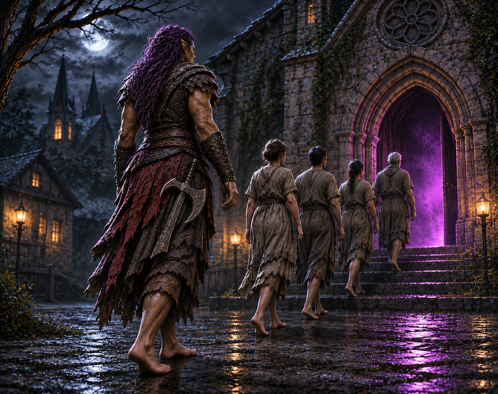

# Children of the crop

> *A bountiful harvest. Bare feet. And something growing beneath the church.*

---

## Delmunster, at three in the morning

After roughly six hours on foot, Ravenlost reached Delmunster at about 3:00 AM. In the dark, two church spires stood conspicuously close together at the edge of town. The group found the Creek Bed Inn and woke its proprietor, Annie, by ringing a bell—a task Matteo enjoyed rather more than the sleeping innkeeper probably did. They secured three rooms and finally rested.

In the morning, Ravenlost discovered their breakfast options were gruel or oats. And every bowl had an odd grayish-green cast.

Now awake, they took this opportunity to speak with Annie. She told them of undead traveling toward Lekar, and of a couple people being conscripted. She also said Commander Korath had come through the Mists roughly six months earlier. The name stopped Bia cold: she had heard “Korath” during the attack that destroyed her childhood home. She told her companions why that name mattered. Whether this commander was connected to the figure from Bia’s past was not yet known.

---

## A confession and two churches

After breakfast, the team decided to go in different directions and investigate the town.

Jain persuaded Elisandra to accompany her to confession. As they walked through town, they noticed everyone was barefoot. They reached the churches and noticed that they were, in fact, identical, except that one was locked up and the other had open doors.

Outside the open church they met Thurston, who explained the villagers’ devotion to the earth and their harvest deity, Hivernus. He told them that the old church had been condemned, and the newer one was its replacement.

Hearing that the older building was condemned, Jain remarked, “I could burn one now, and this time would be fine.” Then, learning that the townspeople also used mushrooms in their religious observances made her so excited, she forgot about burning down the church.

Thurston eventually invited the pair inside. Jain’s confession began with thoughts of harming someone, specifically “a short man with unsettling facial features.” Cadric was probably glad he wasn’t there to hear this.

Jain’s confession became an increasingly elaborate interrogation of the limits of forgiveness. Thurston maintained that all were children of the crop, but Jain wanted to know whether murder was still wrong if the crop forgave her, and whether committing it outside town would change matters.

“The crop forgives, but the crop also remembers,” Thurston warned.

Jain kept pushing, even asking, “Am I too much for you? They said that was me in therapy once too.”

Thurston was defeated, and he steered her toward the prophet when she asked about obtaining mushrooms. The prophet was on her daily sojourn into the woods, but she would be back later in the day.

---

## A backpack, a cudgel, and a pig historian

Bia took Matteo to the shop. “I’ll take a backpack and something sharp to protect myself,” he announced. The shopkeeper explained that Delmunster had no shortage of food, thanks to its abundant harvests. Everything else was another matter. Shipments of clothing and metal goods had become scarce, and he had no sharp weapons to offer.

He did, however, manage to produce a backpack, some secondhand clothes, a pair of worn shoes, and a wooden cudgel.

After leaving the shop, Bia cast Speak with Animals on herself, and she and Matteo went to try to get more information from the farm animals around town.

After failing to get information from a cow who didn’t know anything, Bia found a much more informative local. Sir Oinkington was a pig who considered himself a natural historian. He recalled a brilliant star falling from the sky about six months earlier. Teton, who cared for the pigs, had retrieved something from the fall and taken it to the prophet.

When Bia pressed him on whether Teton had actually caught the star, Sir Oinkington refused to embellish: “I wouldn’t. I don’t know. He had it. Maybe he caught it. That would be wild.”

The pig also reported some unsettling outsiders and asked Bia to put a stop to the weekly slaughter of one of his kind. She promised to relay his request.

---

## Cadric’s unappreciated artistry

Cadric remained at the inn to perform for the handful of patrons. He accompanied his music with a luminous image of a woman washing clothes beside a creek.

The listeners barely looked at him. They swayed, though their movements seemed oddly detached from the rhythm. One finally offered a stiff compliment: “You play music good. Very good.”

Cadric then visited the shop, where he learned little beyond the shortage of shoes and metal supplies as well as the villagers’ seemingly endless bounty of food, thanks to their deity – Hivernus.

---

## A boathouse and some mushrooms

Ravenlost regrouped at the inn to compare notes: the churches, the barefoot townspeople, the brilliant falling star, a shop full of food and nothing else, and Matteo’s new weapon.

The group questioned why Bia would arm an eleven-year-old. Bia explained that Matteo wanted something sharp to protect himself, but the shop had nothing sharper than a wooden cudgel, thanks to the shortage of metal supplies. Besides, she was wielding an axe at a much younger age – maybe 7 or 8.

During the conversation, Matteo slipped away unnoticed. Recognizing that none of them was particularly qualified to supervise an eleven-year-old, the group now took comfort in the fact that he was at least armed.

"He's got a weapon in the backpack. He's better off than 95% of the people in this town right now," Cadric pointed out.

"And he also has some newer shoes," Bia added.

Considering Matteo had survived more than a week alone in the Mists, they decided he was probably fine.

Convincing themselves that Matteo, who had survived more than a week on his own in the Mists, was fine, Cadric went downstairs to question Annie about the churches. Annie told him that construction of the new church had begun about nine months earlier. The timing didn’t neatly match the reported starfall.

Bia went to examine the boathouse. Peeking inside, she saw three boats and an obscene amount of algae hanging from the ceiling. Bia returned to the inn and asked Annie for information about the boathouse. She offered little explanation, except that creek traffic had dwindled, leaving supplies scarce even while food remained plentiful.

Jain and Elisandra returned to the church and sought out Loom, the prophet, to obtain the mushrooms. They found her gently reprimanding Matteo for property damage.

“Sometimes property damage sounds like fun,” Matteo volunteered.

Loom asked whether the two women were responsible for him.

Loom looked from Matteo to Jain and Elisandra. “Is he yours?”

“Not biologically speaking,” Jain replied. “He's more of an adopted child.”

“So you're responsible for him?”

“Not emotionally speaking. Physically, I guess. But I'm not raising him. That's beyond my scope of possibility.” Jain paused. “Was he damaging things?”

Loom explained that Matteo had been trying to break down the door of the condemned church with a stick someone named Bia had purchased for him.

Jain attempted to explain that Matteo had been talking about burning down a church since they arrived. Then they'd discovered Delmunster had *two* churches, and apparently the idea had taken root.

Loom raised an eyebrow. “Well, he's learned from the figures he looks up to.”

“I don't think he should be looking up to me, then,” Jain admitted.

“But you are responsible,” Loom insisted.

Jain decided it was time to change the subject. She claimed that she and Elisandra were honeymooning and were hoping for some mushrooms to celebrate.

When asked how long they had been together, Jain replied, “Not long. Ah, you know, lesbians. It’s only been a few weeks. U-Haul. Am I right?”

The invented honeymoon grew increasingly elaborate as they requested mushrooms to celebrate and commune with the earth.

Loom eventually provided a satchel of dried mushrooms, recommending that they begin with one. Then Jain and Elisandra headed to the store in search of munchies.

---

## The twenty-minute errand

Back at the tavern, Bia found Cadric talking to Annie. She ordered another bowl of oats and found it free of the strange greenish-gray coloring.

After Elisandra, Jain, and Matteo returned, the party gathered in a room, discussed the algae at the boathouse, and considered investigating the condemned church after dark. At this point Cadric also vaguely remembered Gilda Haywood mentioning a “falling star” and a “seed.”

First, they wanted to investigate the food.

Elisandra gave Matteo five copper pieces to fetch a sample bowl of food. The bowl cost two copper, and he could keep the change. While he was gone, the team worked on a plan to go out and investigate at night. Elisandra and Jain also considered whether to take mushrooms. In the end, Jain decided that she wanted to, while Elisandra remained hesitant. Meanwhile, Matteo was still gone, but Ravenlost was only slightly worried.

Matteo finally came back after about twenty minutes. When he returned, he said he had been distracted talking to Annie and had spent two of his remaining copper pieces on porridge for himself, which he ate downstairs.

The sample he brought back looked perfectly ordinary.

Ravenlost went back downstairs to investigate what all the patrons had eaten for dinner. The empty bowls left by diners still bore a greenish tinge.

Jain took a mushroom and went outside to investigate the well. The water was normal well water.

Cadric, Bia, Elisandra, and Matteo found Annie and asked her about her food. She showed them a fresh batch of food, which contained no trace of green, and offered to share her recipe. The pattern remained inexplicable.

---

## A mushroom, a bridge, and a watcher

Back inside the tavern, Jain let them know that the well and the water were normal.

With some time to waste, Cadric played for the eight or nine other patrons.  

The crowd swayed enthusiastically, although apparently none of them had ever encountered rhythm before. They seemed to enjoy the performance, but nobody offered Cadric a single coin. Instead, they showered him with fresh fruits and vegetables. 

Cadric saw Jain go outside and take a second mushroom. She then went toward the creek to sit on the bridge. The rest decided to get a couple hours of sleep before heading outside. Ravenlost sent Matteo to sleep in Cadric's room for the night. Bia and Cadric napped in Bia's room. And Elisandra napped in her room.

Outside, Jain felt the ground fade beneath her feet as the mushrooms took effect. Her final sight before losing consciousness was Matteo watching her from the window of his room.

---

## The procession into the old church

After a short nap, Bia, Cadric, and Elisandra awoke to a deserted tavern. Taking time to investigate, they noticed the kitchen was abnormally clean, though they found no sign of magic.

At the boathouse the hanging algae was all gone. Looking back toward the town, they saw Colt, Annie, Thurston, and another villager walking in uncanny unison toward the well. Cadric broke the boathouse lock and found several sets of fresh, bare footprints.

As they walked further into town, they saw four more groups of four walk across the village in lockstep toward the condemned church. Matteo was among them. And the condemned church’s doors stood open.

Bia decided to follow. She took off her shoes and fell into step, matching the villagers’ movements perfectly, following them down a spiral staircase into the basement. Elisandra tried to reach Jain telepathically but received no answer.

Cadric followed at a distance behind Bia and entered the condemned church stealthily.

Elisandra, meanwhile, investigated a cellar entrance at the newer church. A hidden descent led toward sticky, purple-green tunnels beneath the village.

---

## Jain meets the real harvest

Jain awoke in a cavern, her ankles bound and one hand engulfed by something warm, wet, and pulsating. A pinkish-green membrane crept from her wrist up her arm.

Loom’s familiar voice cautioned her not to interfere. The chamber glowed an unnatural purple-green. Translucent pods covered the walls, connected by tendrils to a towering, fleshy tree-like mass covered in mouths and sores.

Jain’s first strategy was to talk. Constantly. She flirted, asked pointed questions, and tried to make her captor uncomfortable enough to create an opening.

Loom initially indulged her, then asked whether somebody could find a muzzle.

Jain persisted: “I’m so worked up, I can’t function.” Loom finally snapped, “Yeah, I don’t want to deal with that,” and cracked Jain over the head with her staff. “It’ll be a few minutes, and then you’ll join us,” she promised.

Jain promptly resumed questioning her, and Loom indulged her a bit more.

Loom explained that the organism would consume Jain’s body, place her in stasis, and create a duplicate Jain linked to the collective.

“Am I dying?” Jain asked.

“No. You’re being evolved.”

The villagers weren’t copies of one original person, Loom told her. They were copies of themselves. The creature wanted to grow, assimilate others, and ultimately dominate the realm. The assimilation process would take roughly thirty minutes for an adult but less for a child.

The prophet spoke of the village having been changed for about six months, when the creature had fallen from the sky in the form of a glowing orb. Teton, who found the orb, was its first victim.

As the townspeople assembled around the great mass, Jain spotted Matteo—and then Bia, who was still moving in perfect cadence with the assimilated crowd.

“Hey, so prophet lady. I noticed my son and one of my friends is here,” Jain announced, completely outing Bia.

Loom suddenly realized no one had captured Bia. She checked with the collective, heard a chorus of denials, and ordered, “Get her. Get her. Get her.”

Matteo and the others turned on Bia.

Jain acknowledged that she had accidentally outed her friend, then asked where her other companions, Cadric and Elisandra, were. This too was less than helpful for the group trying to rescue her.

Loom sent villagers through the stairs and tunnels to hunt for the remaining party members. Bia’s flawless disguise had lasted until Jain opened her mouth.

---

## The fight beneath Delmunster

The party approached the cavern from different directions, with Cadric positioning himself near the stairs while Elisandra navigated a separate tunnel.

Cadric opened the attack with Cloud of Daggers, catching both the enormous fleshy tree and a nearby villager in its spinning blades. The instant the spell struck the central organism, every creature in the chamber screamed.

That seemed promising.

Cadric followed with an arrow tipped with flesh-corrosive poison. The substance sizzled against the creature, releasing an acrid smell and appearing to inflict considerably more damage than expected.

In the tunnel that connected the churches, Elisandra struck an approaching figure with Guiding Bolt. The target was Matteo. His arm was blown off, revealing white viscous ooze rather than flesh; even grievously injured, the duplicate kept coming. So this wasn’t Matteo. Not anymore. The party now understood how thoroughly the villagers had been changed.

Bia raged into close combat, shoving an enemy into Cadric’s Cloud of Daggers and cleaving at the tree and another attacker. Jain fought her way into the battle while the organism opened into thrashing, razor-edged tentacles. Cadric was knocked unconscious during the struggle. Elisandra’s magic helped the party endure, and Jain ultimately drove an arrow into the creature’s glowing core. The towering mass fell, and its lesser creatures collapsed with it. 

Jain celebrated. “Guys, I contributed to a boss fight.”

---

## What was left of the village

The pods opened after the monster fell. Most held only ooze: the villagers inside had already died as the organism fed on them. Only Annie and Matteo, among the most recently assimilated, emerged alive. 

A barrel of green material in the basement offered a possible connection to the strange food, but the party was too worn out to investigate.

The great orb had gone dark. Ravenlost considered taking it but left it where it lay for now. The party returned to the inn to recover.

---

## A rod, a warning, and one unsent word

Back at the inn and before going to sleep, Cadric finally identified the silver dowsing rod. One charge could locate an object, two charges could locate a creature, and three charges could find a path. The rod held six charges and regained one each dawn. After identification, the rod went back into the bag of holding.

In the morning, the party walked out of the inn to an empty town. More concerning, though, they saw a line of burning braziers stretching east along the Stone Spine Mountains as far as they could see.

Before they had time to worry about an ensuing horde of undead, Lady Estella Godfroy spoke through the sending stone. She asked how Ravenlost had acquired it.

“I, too, am in need of assistance,” it said.

Jain didn’t reply—though she strongly considered answering with a single word: “diarrhea.” There would be time to consider Lady Estella later.

For now, Delmunster’s harvest was over. Whatever awaited beyond, though, it was only beginning.
