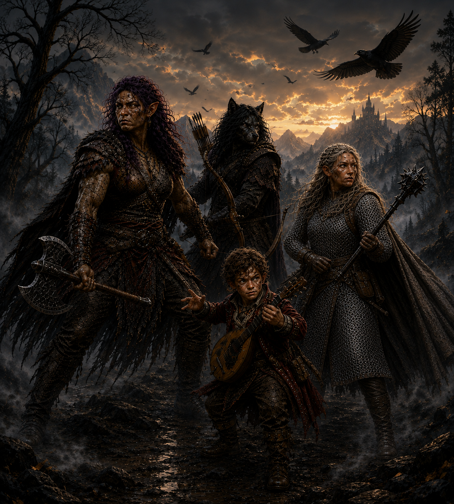

# The Adventures of Ravenlost

*Four strangers. One very bad mist problem.*

Bia, Cadric, Jain, and Elisandra were strangers when they arrived at the Black Raven Inn, each responding to the same job offer.

What started as a simple job has taken them through the Mists, where they've uncovered strange mysteries, battled monsters, encountered more than a few ghosts, and occasionally made extremely questionable decisions.

## Start the adventure

It all began at the Black Raven Inn, with four strangers and a job from a man named Henry Loust.

[**Read Chapter 1: Four strangers in the Mists →**](chapters/chapter01/chapter-01-the-black-lantern-inn.md)

## Where are they now?

<strong>📍 Delmunster, Falkovnia</strong> &nbsp;&nbsp; <strong>⚔️ Level 5</strong>

Ravenlost arrived in Delmunster expecting a safe place to rest, only to
discover a village of barefoot townspeople, suspiciously abundant
harvests, and a horrifying secret beneath a condemned church. After
infiltrating a procession of seemingly hypnotized villagers, the party
battled a monstrous organism that had assimilated nearly the entire
town. They destroyed the creature and rescued Matteo and Annie, the
village's only known survivors.

<strong>Next:</strong> With Delmunster eerily deserted, Ravenlost awakens
to find warning braziers burning along the distant Stone Spine Mountains.
An undead horde may be approaching, Lady Estella Godfroy has requested
their assistance, and Commander Korath remains a troubling connection
to Bia's past. With her family still missing and Lekar still ahead,
Bia and Ravenlost must decide where to go next.

## Follow our adventures

<section class="ravenlost-newsletter" id="subscribe">

  

    Want to know when a new Ravenlost session is published?
    Subscribe to receive an email whenever a new session
    is ready to read.
  

  <form
    id="ravenlost-signup-form"
    action="https://script.google.com/macros/s/AKfycby4H5B-K3WPWPx42ykpNcTaaDz2cB2MRWQl8dbK4C1-dKo5NRqUQnQNobz83JhExdMK_g/exec"
    method="POST"
    target="ravenlost-signup-target"
  >
    

      <label for="ravenlost-name">
        Name
        <input
          type="text"
          id="ravenlost-name"
          name="name"
          autocomplete="name"
          required
        >
      </label>

      <label for="ravenlost-email">
        Email
        <input
          type="email"
          id="ravenlost-email"
          name="email"
          autocomplete="email"
          required
        >
      </label>
    

    <button type="submit" id="ravenlost-signup-button">
      Subscribe
    </button>
  </form>

  <iframe
    name="ravenlost-signup-target"
    id="ravenlost-signup-target"
    title="Newsletter submission"
    hidden
  ></iframe>

  

</section>

