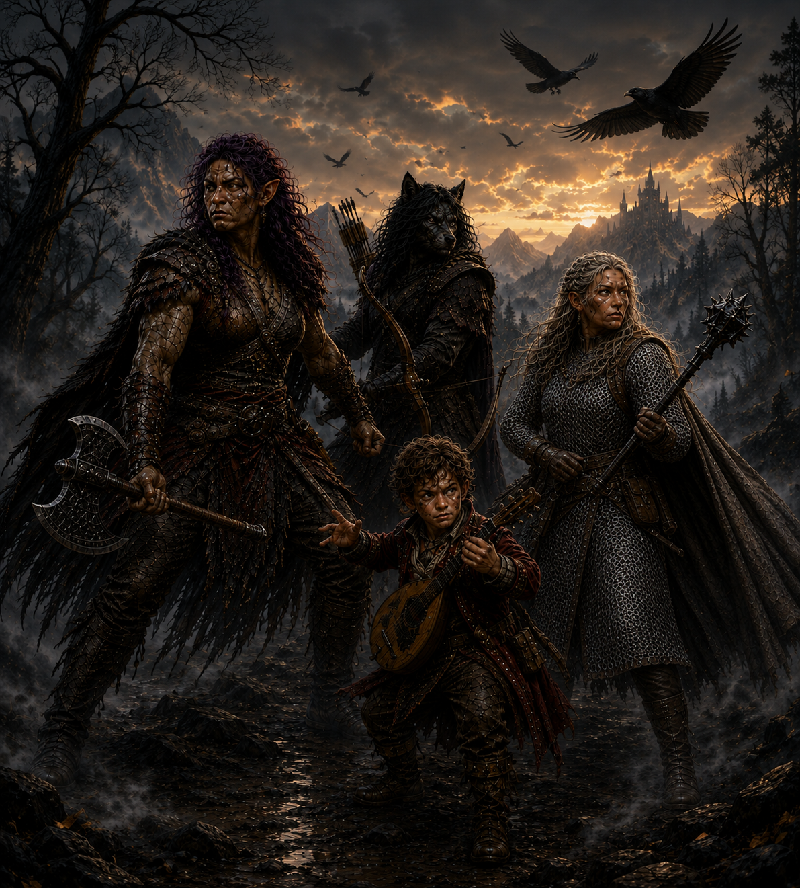

# The Adventures of Ravenlost

*Four strangers. One very bad mist problem.*

Bia, Cadric, Jain, and Elisandra were strangers when they arrived at the Black Raven Inn, each responding to the same job offer.

What started as a simple job has taken them through the Mists, where they've uncovered strange mysteries, battled monsters, encountered more than a few ghosts, and occasionally made extremely questionable decisions.

## Start the adventure

It all began at the Black Raven Inn, with four strangers and a job from a man named Henry Loust.

[**Read Chapter 1: Four strangers in the Mists →**](chapters/chapter01/chapter-01-the-black-lantern-inn.md)

## Where are they now?

<strong>📍 Near the Stone Spine Mountains in Falkovnia</strong> &nbsp;&nbsp; <strong>⚔️ Level 5</strong>

After escaping a spider-infested mine, Ravenlost ventured through the Mists, 
rescued a young boy named Matteo, and witnessed the horrors of an undead 
invasion. They also freed an elderly prisoner from a watchtower and learned 
that Commander Korath—a name haunting Bia's past—rules Falkovnia with an 
iron fist.

<strong>Next:</strong> With Matteo in tow, Ravenlost heads through the 
Forest of Strangers toward Delmunster. But with undead hordes roaming the 
countryside, Bia's family still missing, and a warning not to trust the 
commander, getting to Lekar may prove more dangerous than getting into 
Falkovnia.

## Follow our adventures

<section class="ravenlost-newsletter" id="subscribe">

  

    Want to know when a new Ravenlost session is published?
    Subscribe to receive an email whenever a new session
    is ready to read.
  

  <form
    id="ravenlost-signup-form"
    action="https://script.google.com/macros/s/AKfycby4H5B-K3WPWPx42ykpNcTaaDz2cB2MRWQl8dbK4C1-dKo5NRqUQnQNobz83JhExdMK_g/exec"
    method="POST"
    target="ravenlost-signup-target"
  >
    

      <label for="ravenlost-name">
        Name
        <input
          type="text"
          id="ravenlost-name"
          name="name"
          autocomplete="name"
          required
        >
      </label>

      <label for="ravenlost-email">
        Email
        <input
          type="email"
          id="ravenlost-email"
          name="email"
          autocomplete="email"
          required
        >
      </label>
    

    <button type="submit" id="ravenlost-signup-button">
      Subscribe
    </button>
  </form>

  <iframe
    name="ravenlost-signup-target"
    id="ravenlost-signup-target"
    title="Newsletter submission"
    hidden
  ></iframe>

  

</section>

