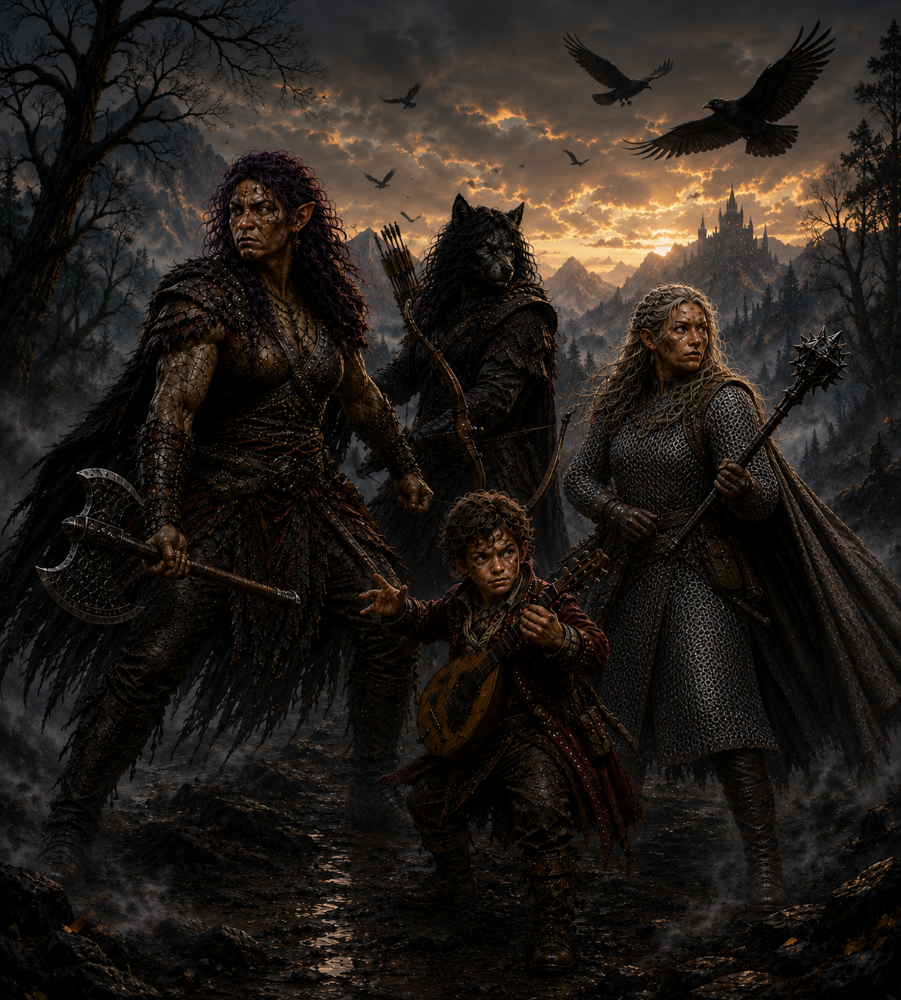

# The Adventures of Ravenlost

*Four strangers. One very bad mist problem.*

Bia, Cadric, Jain, and Elisandra were strangers when they arrived at the Black Raven Inn, each responding to the same job offer.

What started as a simple job has taken them through the Mists, where they've uncovered strange mysteries, battled monsters, encountered more than a few ghosts, and occasionally made extremely questionable decisions.

## Start the adventure

It all began at the Black Raven Inn, with four strangers and a job from a man named Henry Loust.

[**Read Chapter 1: Four strangers in the Mists →**](chapters/chapter01/chapter-01-the-black-lantern-inn.md)

## Where are they now?

<strong>📍 Welkspring House, Echo Island</strong> &nbsp;&nbsp; <strong>⚔️ Level 4</strong>

After surviving the sanatorium and uncovering the truth behind Mordenshire's
murders, Ravenlost has sailed to Echo Island in search of answers about
<strong>Glim Brightstone</strong>. They've reached Welkspring House and met
<strong>Osgood Escar</strong>, an old friend of Glim's who may know more about
his mysterious inventions and disappearance.

<strong>Next:</strong> Inside Welkspring House — learn what Osgood knows
about Glim, and what Lord Godfroy might be planning.

<small>By Bia Galene</small>
